# 競合分析ダッシュボード 操作マニュアル

Googleマップで「近くの〇〇」と検索されたとき、自分の店は何番目に出るのか。近所の同業店と比べて何が足りないのか。
このダッシュボードは、そうした疑問に答えるためのツールです。このマニュアルは、画面を見ながら順番に操作できるように書いています。

> 説明に使う画面はすべて**架空のサンプルデータ**（大阪市中央区・本町付近）です。実在の店舗とは関係ありません。

## 目次

1. [画面の見かた](#1-画面の見かた)
2. [地図タブ](#2-地図タブ)
3. [差別化分析タブ](#3-差別化分析タブ)
4. [キーワード順位タブ](#4-キーワード順位タブ)
5. [順位マップタブ](#5-順位マップタブ)
6. [出店候補地タブ](#6-出店候補地タブ)
7. [店舗一覧タブ](#7-店舗一覧タブ)
8. [自分のデータで使うには](#8-自分のデータで使うには)

---

## 1. 画面の見かた

最初に次の画面が表示されます（ファイルをアップロードしていないときは、サンプルデータです）。

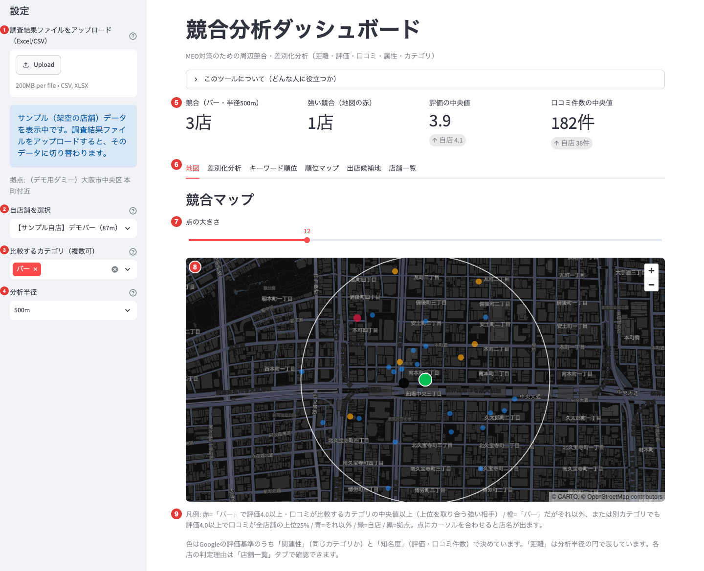

| No. | 場所 | 何をする・何が分かるか |
|---|---|---|
| 1 | ファイルのアップロード | 調査結果のExcel/CSVを読み込みます。サンプルから切り替わります |
| 2 | 自店舗を選択 | 自店を選びます。地図で緑の点になり、各タブの比較の基準になります |
| 3 | 比較するカテゴリ | 競合として比べる業態（カテゴリ）を選びます。複数選べます |
| 4 | 分析半径 | 競合として数える範囲（300m・500m・1000m）を選びます |
| 5 | 4つの数字 | 比較するカテゴリの競合の数や、評価・口コミ件数の目安が一目で分かります |
| 6 | タブ | 見たい分析を切り替えます。いま開いているのは「地図」です |
| 7 | 点の大きさ | 地図の点の大きさを変えます |
| 8 | 地図 | 周辺の競合を、強さに応じた色の点で表示します |
| 9 | 凡例 | 点の色の意味が書いてあります |

左側の1〜4（サイドバー）の設定は、**すべてのタブに共通**です。変えると、地図の色もほかのタブの集計も変わります。

---

## 2. 地図タブ

### 2-1. この画面で分かること

自店のまわりに、**どんな競合が、どこに、どのくらい強い状態で**いるかを地図で確認できます。
Googleが検索順位を決めるときに使う基準のうち、次の3つをもとに色を付けています。

| Googleの基準 | この地図での扱い |
|---|---|
| 関連性（検索された言葉と店が合っているか） | 比較するカテゴリ（業態）の店かどうか |
| 知名度（どれだけ知られ、評価されているか） | 評価と口コミ件数 |
| 距離（検索した人の場所から近いか） | 分析半径の円（地図上の白い円） |

### 2-2. まず、サイドバーを確認する

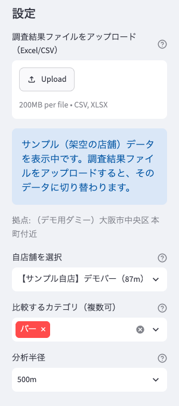

1. **自店舗を選択**: 自店の名前を選びます（サンプルでは「【サンプル自店】デモバー」）。選ぶと、地図の中心が自店になり、数字の下に「自店」の値も表示されます。選ばないときは、データを集めた中心の位置（拠点）が地図の中心になります。
2. **比較するカテゴリ（複数可）**: 自店を選ぶと、そのお店のカテゴリ（サンプルでは「バー」）が自動で入ります。「×」で外し、別のカテゴリを選べます。複数選ぶと、まとめて1つのグループとして比べます（例: バーとラウンジバー）。何も選ばなければ、全店舗が比べる対象になります。
3. **分析半径**: 自店から何m以内の店を競合として数えるかを選びます。初期値は500mです。

> **まだ出店していない方へ**: 自店は選ばず、「比較するカテゴリ」に出店予定の業態を選んでください。地図の中心はデータを集めた中心の位置になります。

### 2-3. 上の4つの数字を見る

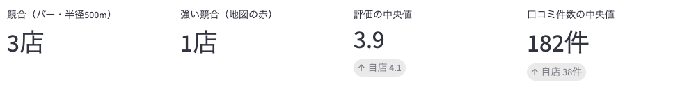

画面の上にある数字は、次の内容です。サンプルデータでの値も示します。

| 数字 | 意味 | サンプルの値 |
|---|---|---|
| 競合（バー・半径500m） | 比較するカテゴリの店のうち、分析半径内にいる店の数（自店を除く） | 3店 |
| 強い競合（地図の赤） | 地図で赤く表示される店の数 | 1店 |
| 評価の中央値 | 競合の評価の真ん中の値。下に自店の評価が出ます | 3.9（自店 4.1） |
| 口コミ件数の中央値 | 競合の口コミ件数の真ん中の値。下に自店の件数が出ます | 182件（自店 38件） |

**見かたの例**: サンプルの自店は、評価（4.1）は競合の中央値（3.9）より高いものの、口コミ件数（38件）は競合の中央値（182件）よりかなり少ない状態です。「評価は良いが、口コミがまだ足りない店」だと分かります。

> 平均ではなく**中央値**（順番に並べたときの真ん中の値）を使っています。口コミが極端に多い店が1店あっても、数字が引っぱられないようにするためです。

### 2-4. 地図を見る

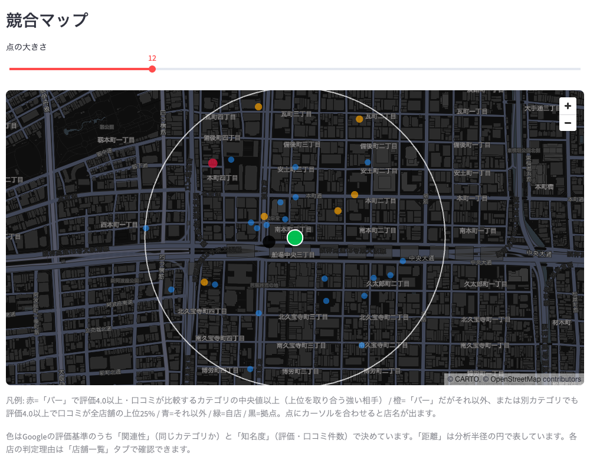

地図の中心にいる**緑の点**が自店です。白い円は分析半径（ここでは500m）で、円の中にある店が競合として数えられます。

点の色の意味は次のとおりです。

| 点 | 意味 |
|---|---|
| 赤（大きい） | **強い競合**。比較するカテゴリの店で、評価が4.0以上、かつ口コミ件数が比較するカテゴリの中央値以上。同じ検索で上位を取り合う相手です |
| 橙 | 競合になりうる店。比較するカテゴリの店だが赤の条件には届かない店、または別のカテゴリでも評価4.0以上で口コミ件数が全店舗の上位25%に入る店 |
| 青（小さい） | 直接の競合ではない店（別のカテゴリで、上の条件を満たさない店） |
| 緑（大きく白い縁） | 自店 |
| 黒 | 拠点（データを集めるときの中心の位置） |

**サンプルでの見かた**: 自店のそばに赤い点は1つだけです（地図の左上寄り）。橙の点は、別のカテゴリの強い店などです。まず赤い点が自店からどれくらい離れているかを見ると、近くに強いライバルがいるかどうかが分かります。

### 2-5. 点にカーソルを合わせる

地図の点にマウスのカーソルを合わせると、店名が表示されます。

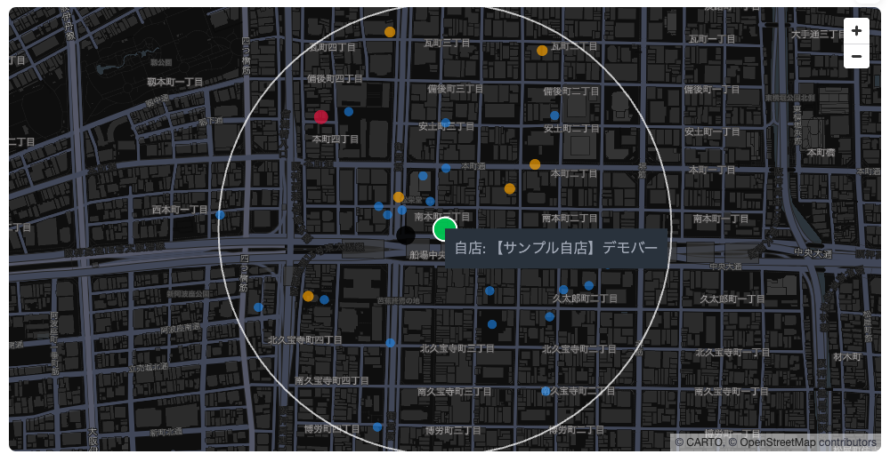

- 競合の点: 「店名（競合度: 高）」のように、店名とその店の競合度（高・中・低）が出ます。高が赤、中が橙、低が青にあたります。
- 緑の点: 「自店: 店名」
- 黒の点: 「拠点（データ収集の中心）」

地図はマウスのドラッグで動かせます。右上の「＋」「－」（またはマウスのホイール）で拡大・縮小できます。

### 2-6. 点の大きさを変える

点が小さくて見づらいときや、点が重なって見づらいときは、地図の上のスライダー「点の大きさ」で調整します。初期値は12で、6〜30の間で変えられます。

| 初期値（12） | 大きくしたとき（24） |
|---|---|
|  | 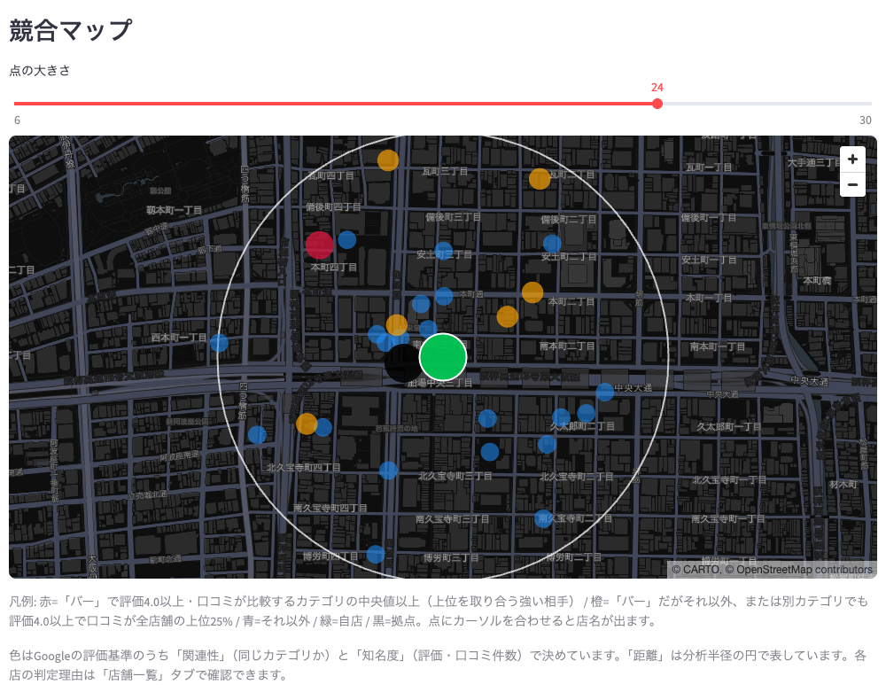 |

点を大きくすると、遠くから見ても色が分かりやすくなります。逆に店が多いエリアでは、小さくすると重なりが減ります。

### 2-7. 見るときの注意

- **色は、このツール独自の目安です**。Googleが実際に使っている順位の計算そのものではありません。「評価が高く、口コミが多い、同じ業態の店」を強いライバルとして見つけるためのものです。
- 各店がなぜその色になったかは、「店舗一覧」タブの「競合度の理由」の列で確認できます。
- 地図に出るのは、分析半径の円の中にある店だけです。位置の情報がない店は表示されません。
- 「比較するカテゴリ」を変えると、色が付く店も変わります。たとえば出店予定の業態を選ぶと、その業態の競合だけが赤・橙になります。

### 2-8. 地図を見たあとは

地図で「強い競合がどこにいるか」が分かったら、次は[差別化分析タブ](#3-差別化分析タブ)で、競合と比べて自店のプロフィールに足りない項目や、自店だけの強みを確認します。

---

## 3. 差別化分析タブ

### 3-1. この画面で分かること

周辺の競合と自店を比べて、プロフィールの**足りない項目**と**自店だけの強み**を見つけます。比べるのは、テラス席・予約可・カクテルなど、Googleマップのプロフィールに登録できる「属性」です。登録内容が充実しているほど、検索された言葉と店の情報が合う場面が増え、Googleの基準の「関連性」を高めることにつながる可能性があります。

> 自店を選んでいないと、自店との比較（判定・候補・「自店」の欄）は表示されません。サイドバーで自店を選んでください。

### 3-2. 比較する相手を選ぶ

画面の上にある「比較対象」で、どの競合と比べるかを選びます。

| 選択肢 | 意味 |
|---|---|
| 比較するカテゴリ（バー・3店） | サイドバーの「比較するカテゴリ」の競合だけと比べます |
| 周辺の全競合（28店） | 分析半径内のすべての競合と比べます |

同じカテゴリの競合が**10店以上**いるときは「比較するカテゴリ」が最初に選ばれ、それより少ないときは「周辺の全競合」が選ばれます。サンプルはバーが3店しかいないため、「周辺の全競合」になっています。選び直すと、このタブの数字がすべて変わります。

### 3-3. 説明文・プロフィールに反映する候補

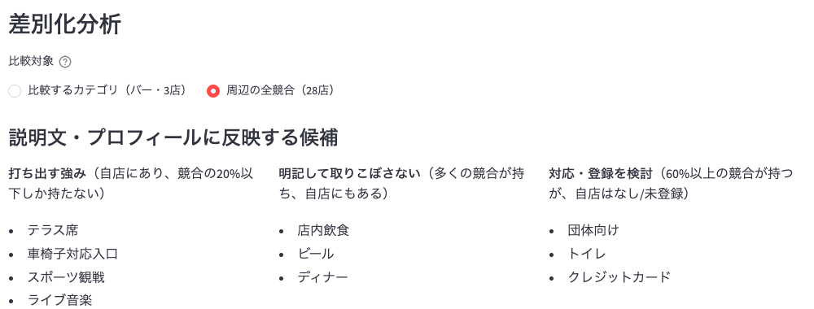

3つの欄に、すぐ使える候補が出ます。

| 欄 | 意味 | サンプルでの例 |
|---|---|---|
| 打ち出す強み | 自店にあり、競合の20%以下しか持っていない属性。ほかの店と差をつけられます | テラス席・車椅子対応入口・スポーツ観戦・ライブ音楽 |
| 明記して取りこぼさない | 多くの競合（60%以上）が持ち、自店にもある属性。説明文にも書いておくと安心です | 店内飲食・ビール・ディナー |
| 対応・登録を検討 | 60%以上の競合が持っているのに、自店は「なし」または未登録の属性 | 団体向け・トイレ・クレジットカード |

**見かたの例**: 「団体向け」は多くの競合が登録しているのに、自店は未登録です。団体の予約を受けているなら、プロフィールに登録するだけで差が縮まります。

> 実際に対応していない項目は登録しないでください。事実と違う登録は、お客さまの期待とのずれになり、かえって逆効果です。

### 3-4. 属性の保有率

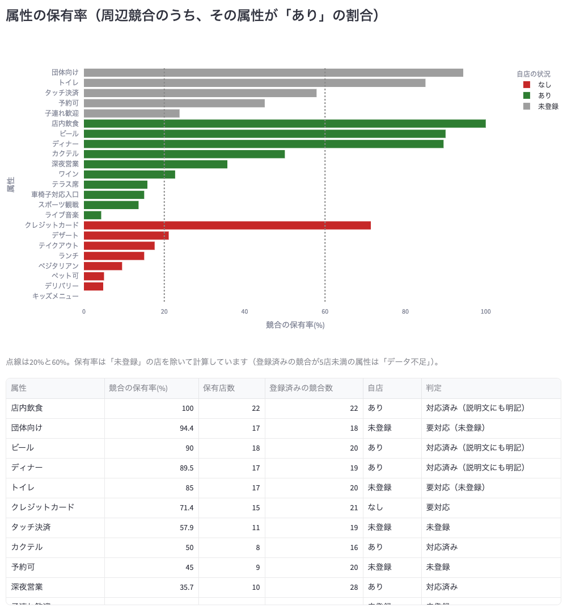

属性ごとに、競合の何%が「あり」としているかを表します。

- **棒の長さ**: 競合の保有率です。2本の点線は20%と60%の目安です。
- **棒の色**: 自店の状況です。緑は「あり」、赤は「なし」、灰色は「未登録」です。
- 保有率は、「未登録」の店を除いて計算しています。

下の表の「判定」は、次の意味です。

| 判定 | 意味 |
|---|---|
| 要対応（未登録）／要対応 | 60%以上の競合が持っているのに、自店は未登録／「なし」 |
| 対応済み（説明文にも明記） | 60%以上の競合が持ち、自店にもある |
| アピールポイント | 自店にあり、競合の20%以下しか持っていない |
| 差別化の候補 | 競合の20%以下しか持っておらず、自店は「なし」。取り入れれば強みになる可能性があります |
| 未登録 | 自店が未登録で、競合の保有率は60%未満（急いで対応する必要はありませんが、登録すると充実度が上がります） |
| —（ダッシュ） | 自店は「なし」で、競合の保有率も20〜60%。特に対応は不要です |
| データ不足 | 登録済みの競合が5店未満で、判定できません |

**見かたの例**: 「団体向け」は競合の94.4%が持っていて、自店は未登録なので「要対応（未登録）」です。「クレジットカード」は競合の71.4%が持っているのに自店は「なし」なので「要対応」です。

### 3-5. メインカテゴリの分布

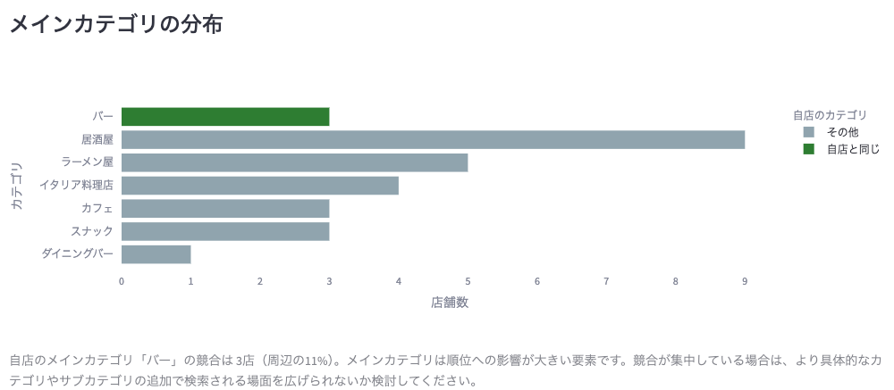

周辺の競合が、どのカテゴリに何店いるかを棒グラフで表します。緑の棒が自店と同じカテゴリです。このグラフは、比較対象の選び方にかかわらず、分析半径内のすべての競合で表示します。

サンプルでは、居酒屋が9店で最も多く、自店と同じバーは3店（周辺の11%）です。同じカテゴリの店が多いときは、より具体的なカテゴリやサブカテゴリを追加して、検索される場面を広げられないか検討してください。

### 3-6. プロフィール充実度

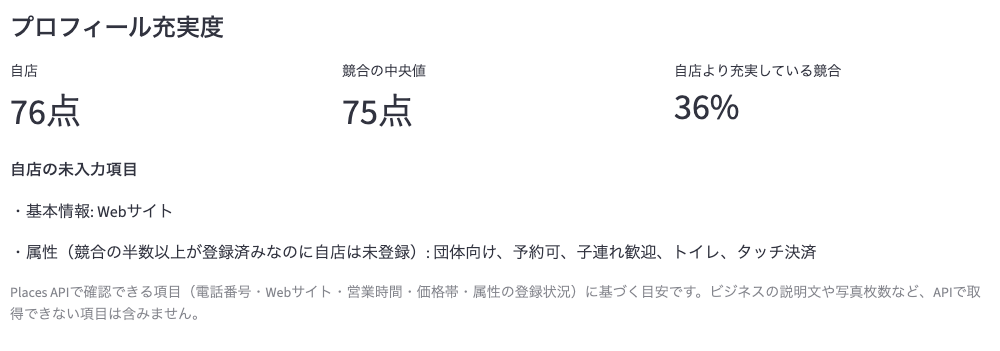

電話番号・Webサイト・営業時間・価格帯・属性の登録状況から、プロフィールの充実度を100点満点の目安で出します。

| 数字 | 意味 | サンプルの値 |
|---|---|---|
| 自店 | 自店の充実度 | 76点 |
| 競合の中央値 | 競合の充実度の真ん中の値 | 75点 |
| 自店より充実している競合 | 自店より点数の高い競合の割合 | 36% |

その下の「自店の未入力項目」には、競合の半数以上が登録しているのに自店が未登録の項目が出ます。サンプルでは、基本情報のWebサイトと、属性の団体向け・予約可・子連れ歓迎・トイレ・タッチ決済です。

**見かたの例**: 自店は競合の中央値とほぼ同じ点数です。未入力の項目を登録すれば、競合より上に立てます。

> 事業の説明文や写真の枚数など、取得できない項目は点数に含まれません。目安としてご覧ください。

---

## 4. キーワード順位タブ

### 4-1. この画面で分かること

「bar」「スナック」などのキーワードで検索したとき、自店と競合が**何位に表示されるか**が分かります。上位の店の口コミ件数・評価と比べて、上位に入るために何が足りないかの目安も確認できます。

> **分かるのは「何位に出るか」で、「そのキーワードが月に何回検索されているか」（検索回数）は分かりません。** 順位は、データを集めた中心の位置（拠点）で検索した結果の並び順にもとづく目安です。実際の順位は、検索する人の場所や時間などで変わります。上位60件までを記録しています。

### 4-2. 表示するキーワードを絞る

画面の上に、次のスイッチがあります。

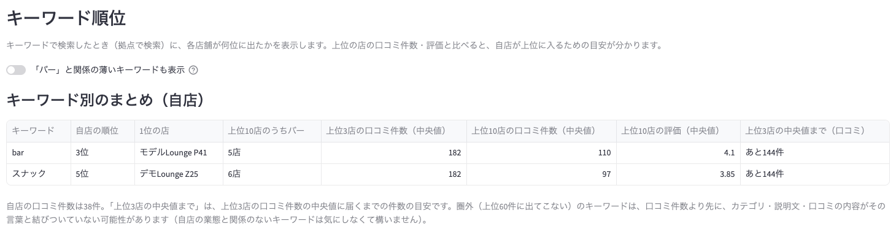

| 操作 | 表示されるキーワード |
|---|---|
| スイッチがオフ（初期値） | サイドバーで選んだカテゴリと関係のあるキーワードだけ。上位10店のうち3店以上がそのカテゴリの店であるキーワードと、自店が表示されるキーワードです |
| スイッチをオン | すべてのキーワード |

サンプルでは、バーと関係のある「bar」と「スナック」だけが表示されています。ラーメンや居酒屋などのキーワードを見たいときは、スイッチをオンにします。

### 4-3. キーワード別のまとめ

上の表は、キーワードごとに自店の状況をまとめたものです。

| 列 | 意味 | サンプルの値（bar） |
|---|---|---|
| 自店の順位 | そのキーワードで自店が何位か。上位60件に出てこないときは「圏外」 | 3位 |
| 1位の店 | そのキーワードで1位の店 | モデルLounge P41 |
| 上位10店のうち（カテゴリ名） | 上位10店のうち、選んだカテゴリの店の数 | 5店 |
| 上位3店の口コミ件数（中央値） | 上位3店の口コミ件数の真ん中の値 | 182 |
| 上位10店の口コミ件数（中央値） | 上位10店の口コミ件数の真ん中の値 | 110 |
| 上位10店の評価（中央値） | 上位10店の評価の真ん中の値 | 4.1 |
| 上位3店の中央値まで（口コミ） | 自店の口コミ件数が、上位3店の中央値に届くまでの件数の目安 | あと144件 |

**見かたの例**: 「bar」で自店は3位に入っています。ただ、自店の口コミ件数（38件）は上位3店の中央値（182件）よりかなり少なく、順位を保ち、上げていくには口コミを増やす必要がありそうです。

> **「圏外」のキーワードの見かた**: 自店が圏外のキーワードは「上位3店の中央値まで」に「—」と出ます。圏外の原因は口コミ件数の不足より先に、カテゴリや説明文がその言葉と結びついていないことである場合が多いためです。自店の業態と関係のないキーワード（バーなのに「ラーメン」など）は、気にしなくて構いません。

### 4-4. キーワードを選んで詳しく見る

「キーワード」の選択欄で1つ選ぶと、そのキーワードで検索に出た店を、口コミ件数と評価の図で確認できます。初期値は、自店の順位がいちばん高いキーワードです。

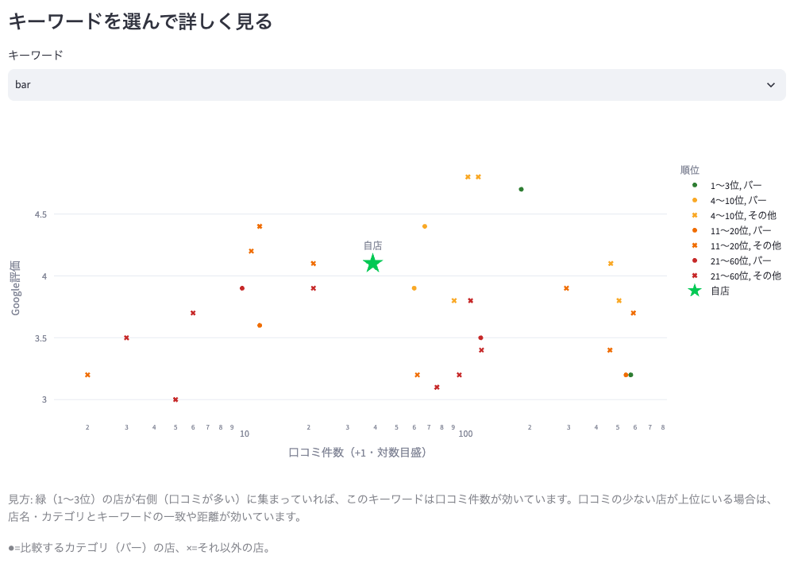

| 図の見かた | 意味 |
|---|---|
| 横軸 | 口コミ件数。目盛は10、100と増えるごとに間隔が一定になる「対数目盛」で、口コミが多い店と少ない店が離れすぎないようにしています |
| 縦軸 | Googleの評価 |
| 点の色 | 順位。緑が1〜3位、黄が4〜10位、橙が11〜20位、赤が21〜60位 |
| ●と× | ●が選んだカテゴリの店、×がそれ以外の店 |
| 緑の星 | 自店 |

**見かたの例**: 緑（1〜3位）の点が右のほう（口コミが多い側）に集まっていれば、そのキーワードでは口コミ件数が順位に効いています。口コミの少ない店が上位にいる場合は、店名やカテゴリがキーワードとよく合っているか、距離が近いことが効いていると考えられます。

図の下には、順位の表があります。

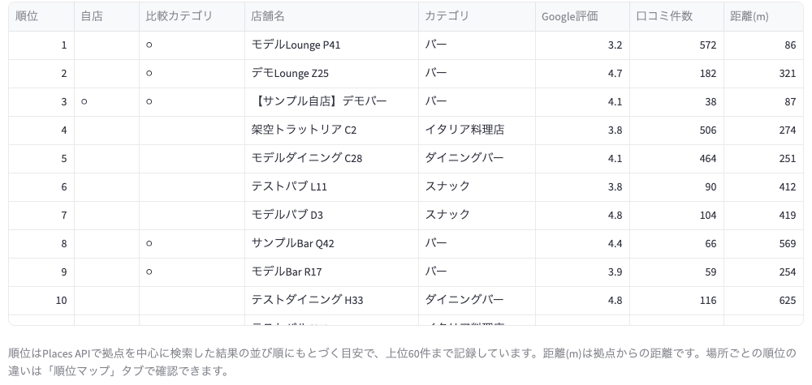

順位・店舗名・評価・口コミ件数に加えて、自店の行には「自店」の列に○が付き、選んだカテゴリの店には「比較カテゴリ」の列に○が付きます。「距離(m)」は、拠点からの距離です。

**見かたの例**: サンプルの「bar」では、1位が口コミ572件、2位が182件、自店は3位で38件です。上位2店は口コミが多く、自店は少ない件数で3位に入っていることが分かります。

---

## 5. 順位マップタブ

### 5-1. この画面で分かること

同じキーワードでも、**検索する場所によって順位は変わります**。このタブでは、データを集めた中心（基点）と、そのまわりの8方向（北・南・東・西・北東・北西・南東・南西）の合計9か所で検索したときに、選んだ店が何位に出たかを地図で確認できます。「駅の北側では上位なのに、南側では下位」といった、場所による強さの違いが分かります。

### 5-2. キーワードと店を選んで、地図を見る

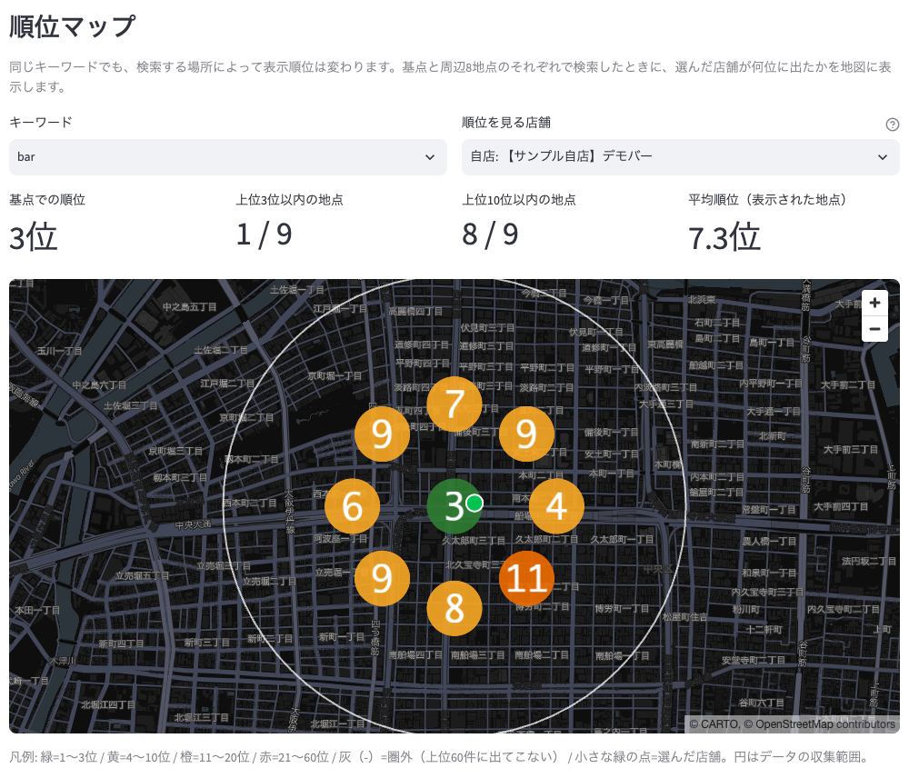

最初に、画面の上で次の2つを選びます。

| 選ぶもの | 意味 |
|---|---|
| キーワード | 順位を見たい検索キーワード（サンプルでは「bar」） |
| 順位を見る店舗 | 初期値は自店。競合の店を選ぶと、その店がどの場所で強いかが分かります |

その下の4つの数字と、地図の見かたは次のとおりです。

| 項目 | 意味 | サンプルの値 |
|---|---|---|
| 基点での順位 | 基点で検索したときの順位 | 3位 |
| 上位3位以内の地点 | 9か所のうち、3位以内に入った場所の数 | 1 / 9 |
| 上位10位以内の地点 | 9か所のうち、10位以内に入った場所の数 | 8 / 9 |
| 平均順位 | 順位が出た場所の平均 | 7.3位 |
| 丸の数字と色 | その場所での順位。緑が1〜3位、黄が4〜10位、橙が11〜20位、赤が21〜60位、灰色の「-」が圏外（上位60件に出てこない） | 基点は緑の3位、南東は橙の11位 |
| 小さな緑の点 | 選んだ店の実際の位置 | |
| 白い円 | データを集めた範囲 | |

**見かたの例**: サンプルの自店は、基点では3位ですが、南東では11位まで下がります。9か所のうち8か所で10位以内に入っているので、全体としては強い一方、南東側は弱いことが分かります。

### 5-3. 場所ごとの内訳とキーワード別のまとめ

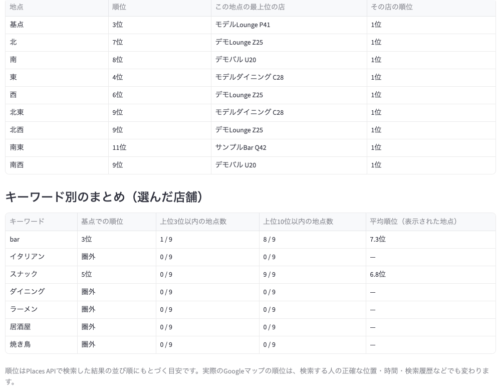

地図の下の表は、場所ごとの内訳です。「この地点の最上位の店」には、その場所で1位だった店が出ます。自店より上にいる店が、場所によってどう入れ替わるかを確認できます。

その下の「キーワード別のまとめ」は、選んだ店について、すべてのキーワードの結果を一覧にしたものです。

| 列 | 意味 |
|---|---|
| 基点での順位 | 基点で検索したときの順位。上位60件に出てこないときは「圏外」 |
| 上位3位以内の地点数／上位10位以内の地点数 | 9か所のうち、その順位以内に入った場所の数 |
| 平均順位 | 順位が出た場所の平均。1か所も出なければ「—」 |

**見かたの例**: サンプルでは「スナック」で、基点では5位ですが、9か所すべてで10位以内に入っています。場所による差が小さく、安定して表示されるキーワードだと分かります。

> 順位は、Places APIで検索した結果の並び順にもとづく目安です。実際のGoogleマップの順位は、検索する人の正確な位置・時間・検索履歴などでも変わります。
> 半径が300m以下のデータでは、検索する場所が基点の1か所だけになります。また、古い形式のファイル（「地点別順位」のシートがないもの）では、このタブは使えません。

---

## 6. 出店候補地タブ

### 6-1. この画面で分かること

まだ出店していない場所の住所を入れると、その周りにある競合の数・評価・口コミ件数を、**契約前に**比べられます。最大5か所を並べて確認できます。

> **使うときの条件**: 集計に使うのは、読み込んだデータに含まれている店舗だけです。候補地は、データを集めた範囲（地図の大きい円）の中にある必要があります。出店の検討に使う場合は、候補地を囲むように、半径1000mでデータを集めてください（[8. 自分のデータで使うには](#8-自分のデータで使うには)）。

### 6-2. 住所を入れて比べる

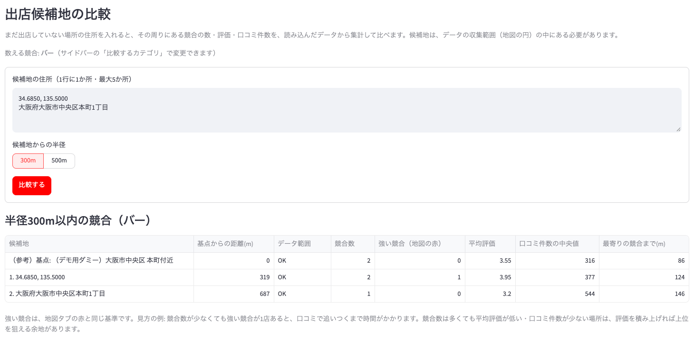

1. **候補地の住所**に、1行に1か所ずつ入力します（サンプルでは、緯度・経度と住所を1か所ずつ入れています）。住所のかわりに「34.6850, 135.5000」のように緯度と経度でも指定できます。
2. **候補地からの半径**を、300mか500mから選びます。
3. 「比較する」を押します。

数える競合は、サイドバーの「比較するカテゴリ」の店です（サンプルではバー）。結果の表は、次の見かたです。

| 列 | 意味 |
|---|---|
| 候補地 | 入力した候補地。いちばん上の「（参考）基点」は、データを集めた中心の位置です |
| 基点からの距離(m) | 候補地が、データの中心からどれだけ離れているか |
| データ範囲 | OK＝集計できる。「一部が範囲外」＝競合の数は少なめに出る。「範囲外」＝集計できない |
| 競合数 | 候補地から指定の半径内にいる、比べる競合の店の数 |
| 強い競合（地図の赤） | そのうち、地図で赤になる店の数 |
| 平均評価・口コミ件数の中央値 | 競合の評価と口コミ件数の目安 |
| 最寄りの競合まで(m) | 候補地からいちばん近い競合までの距離 |

**見かたの例**: 候補地1は競合が2店で、うち1店が強い競合です。候補地2は競合が1店で、強い競合はなく、平均評価も3.2と低めです。口コミで追いつくまでに時間のかかる強いライバルがいない分、評価を積み上げれば上位を狙える余地があります。

> 住所から位置を求める処理には、国土地理院の住所検索（無料）を使っています。町名や丁目までの住所は、その区域の代表点の位置になります。住所が見つからないときは、表記を変えるか、緯度・経度で指定してください。

### 6-3. 候補地を地図で見る

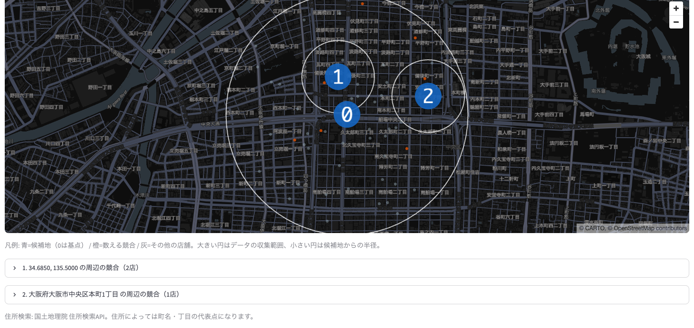

| 地図の見かた | 意味 |
|---|---|
| 青い丸の数字 | 候補地（0は基点、1・2は入力した順番）。まわりの小さな円が、候補地からの半径です |
| 橙の点 | 数えている競合の店 |
| 灰色の点 | それ以外の店 |
| 大きい白い円 | データを集めた範囲 |

地図の下にある「〇〇の周辺の競合」を開くと、その候補地の近くにいる競合の店の一覧（店名・距離・評価・口コミ件数など）が出ます。

---

## 7. 店舗一覧タブ

### 7-1. この画面で分かること

読み込んだデータの**全店舗**を、自分で検索したり、条件で絞り込んだりして確認できます。絞り込んだ結果は、Excelで開けるCSVとして保存できます。

### 7-2. 検索・絞り込みの条件

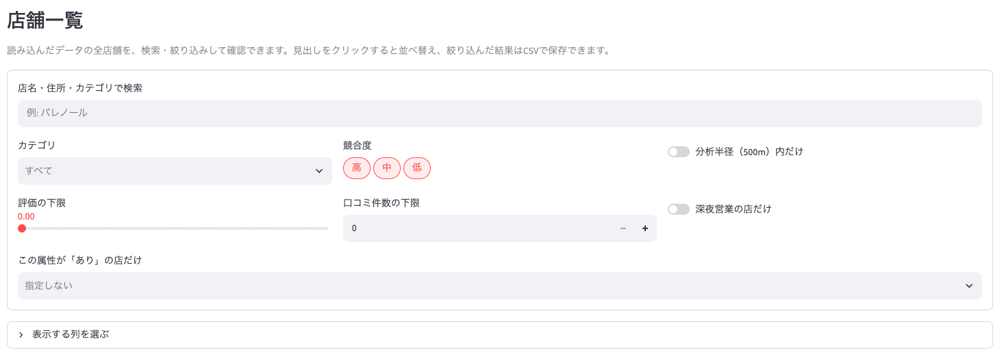

| 条件 | 使いかた |
|---|---|
| 店名・住所・カテゴリで検索 | 文字を入れると、一致する店だけに絞ります（例: 「パレノール」と入れると、同じビルの店が並びます） |
| カテゴリ | 見たいカテゴリを選びます（複数可） |
| 競合度 | 高・中・低から選びます。地図の赤・橙・青に対応しています |
| 分析半径内だけ | オンにすると、サイドバーで選んだ分析半径の内側の店だけにします |
| 評価の下限／口コミ件数の下限 | 評価や口コミ件数が一定以上の店だけにします |
| 深夜営業の店だけ | オンにすると、深夜営業の店だけにします |
| この属性が「あり」の店だけ | 属性（テラス席・予約可など）を選ぶと、それが「あり」の店だけにします（複数選ぶと、すべてが「あり」の店） |

「表示する列を選ぶ」を開くと、表に出す列を選べます。営業時間・電話番号・属性なども選べます。

### 7-3. 一覧を見る・保存する

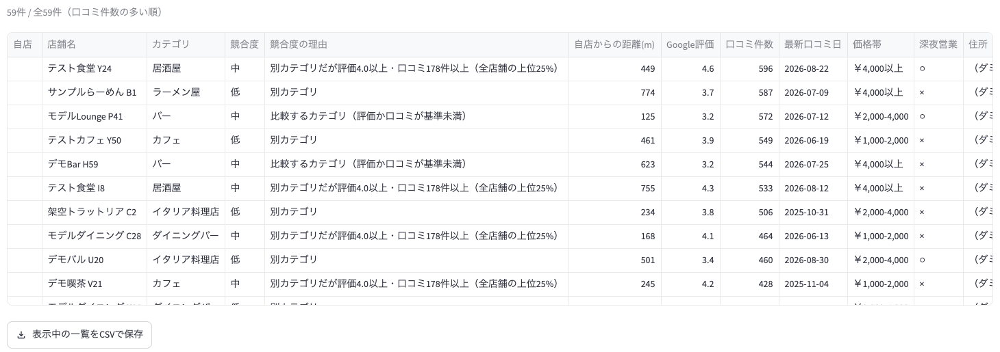

- 表の上には、絞り込み後の件数が出ます。並びは口コミ件数の多い順です。
- 表の見出しをクリックすると、その列で並べ替えられます。
- 「競合度」の列は地図の色に、「競合度の理由」の列は、その色になった理由に対応しています。たとえば「別カテゴリだが評価4.0以上・口コミ178件以上（全店舗の上位25%）」の店は、別のカテゴリですが評価と口コミが強いため、競合度が「中」になっています。
- 表の中の「Googleマップ」の列の「開く」をクリックすると、その店のGoogleマップのページが開きます。
- 「表示中の一覧をCSVで保存」を押すと、絞り込んだ結果が、表示している列のまま保存されます。ファイルはExcelで開いても文字化けしません。

---

## 8. 自分のデータで使うには

ここまでの画面はサンプルデータで説明しました。ご自身のエリアのデータで使うには、まず、調査結果のExcelファイルを作ります。

### 8-1. 全体の流れ

1. Google Maps Platformで、ご自身のAPIキーを用意します（無料枠があります）。
2. 付属の「collector」で、エリアの店舗データを取得し、Excelファイルに出力します。
3. このダッシュボードのサイドバーから、そのExcelファイルをアップロードします。

アップロードしたファイルは、そのブラウザの中だけで使われ、サーバーには保存されません。このダッシュボードは、アップロードされたデータを表示するだけで、Googleのサービスを呼び出しません。

### 8-2. データを取得する（collector）

準備と詳しい設定は、READMEの「事前準備」「STEP 1」を参照してください。コマンドは次のようになります。

```bash
uv run python -m collector.export --address "大阪府大阪市中央区本町1丁目" --label 本町 --radius 500
```

| オプション | 意味 |
|---|---|
| --address | データを集める中心の住所（自店の住所でかまいません） |
| --label | ファイル名などに使う、わかりやすい名前 |
| --radius | データを集める半径。300・500・1000のどれか |
| --estimate | APIを呼ばずに、今月の使用回数と、今回の最大呼び出し回数だけを表示します |

実行が終わると、`places_<ラベル>_<半径>m_<日時>.xlsx` というファイルができます。これをダッシュボードにアップロードします。

**使い分けの目安**

| 目的 | 半径の目安 |
|---|---|
| 営業中の店の競合分析 | 500m |
| 出店候補地の比較 | 1000m（候補地を囲む範囲で集める） |

> **費用について**: Google Maps Platformには月ごとの無料枠があります。collectorは、無料枠を超えそうなときは、APIを呼ぶ前に自動で中止します。ただし、同じアカウントでほかにもAPIを使っている場合は、その分はここで記録されません。実行前に `--estimate` で確認し、Google Cloud Consoleの利用状況と予算アラートも設定してください。

### 8-3. アップロードして使う

1. ダッシュボードを開き、サイドバーの「調査結果ファイルをアップロード」に、Excelファイルをドラッグします。サンプルから、ご自身のデータに切り替わります。
2. 「自店舗を選択」で、自店を選びます。出店前の場合は、自店は選ばずに、「比較するカテゴリ」に出店予定の業態を選びます。
3. あとは、[2. 地図タブ](#2-地図タブ)から順に見ていきます。

> 順位マップは、collectorの最新版で取得したファイルで使えます。古い形式のファイルでは「地点別順位」のシートがないため、順位マップは表示されません（ほかのタブは、古い形式のファイルでも使えます。ただし、キーワード順位のシートがないファイルでは、キーワード順位タブも表示されません）。
